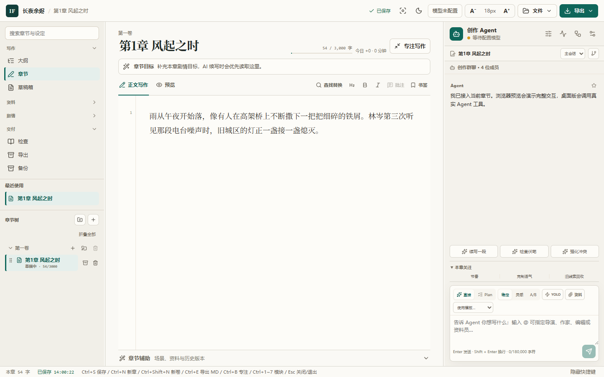
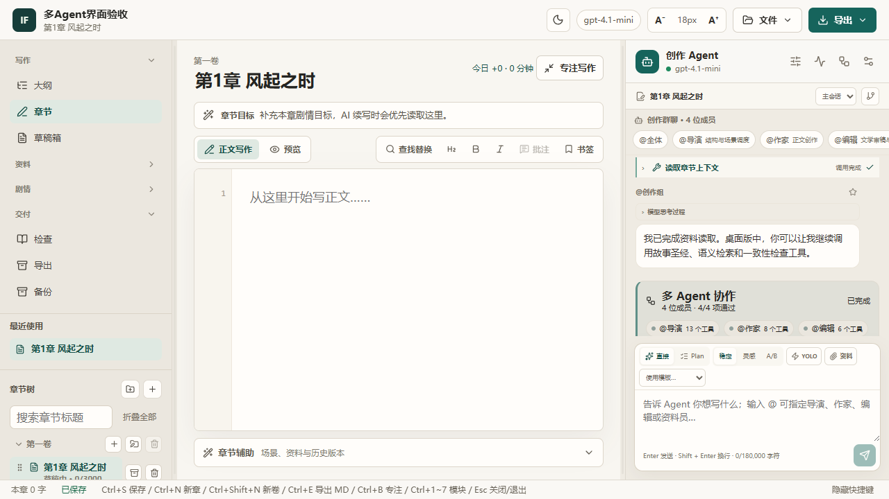
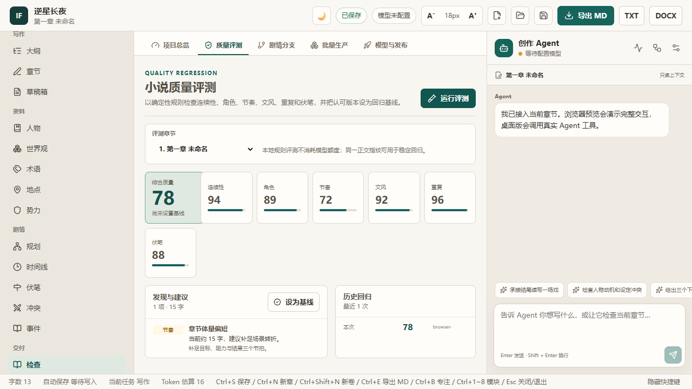

<p align="center">
  
</p>

<h1 align="center">InkForge 小说工坊</h1>

<p align="center">
  面向小说作者的本地优先 AI 创作驾驶舱：让 AI 参与工作，但不交出作品、数据与最终决定权。
</p>

<p align="center">
  <a href="./README.md">English</a> · <a href="./README.zh-CN.md">简体中文</a>
</p>

<p align="center">
  <a href="https://github.com/drowned-fish1/InkForge-Novel-Studio/actions/workflows/ci.yml"></a>
  <a href="./LICENSE"></a>
  
  
</p>

<p align="center">
  <a href="#快速开始">快速开始</a> ·
  <a href="#产品一览">产品一览</a> ·
  <a href="./docs/user-guide.md">用户指南</a> ·
  <a href="./docs/architecture.md">架构</a> ·
  <a href="./docs/roadmap-next.md">路线图</a>
</p>

<picture>
  <source media="(prefers-color-scheme: dark)" srcset="./docs/assets/readme/writing-workspace-dark.png" />
  
</picture>

> [!IMPORTANT]
> InkForge 当前处于 **v1.0 候选发布阶段**。应用已可使用并有自动化测试覆盖，但公开 Windows 构建尚未签名，可能触发 SmartScreen。详情见[项目状态](#项目状态)。

Windows 用户可从 [v1.0.0-rc.5 发布页](https://github.com/drowned-fish1/InkForge-Novel-Studio/releases/tag/v1.0.0-rc.5)下载安装包并核对 SHA-256。

## 为什么是 InkForge

| 作品始终属于你                                                                               | AI 始终受你控制                                                                        | 一处管理整部长篇                                                             |
| -------------------------------------------------------------------------------------------- | -------------------------------------------------------------------------------------- | ---------------------------------------------------------------------------- |
| 章节、大纲、故事资料、历史与备份都保存在你选择的文件夹中。核心写作流程不需要账号或 API Key。 | Agent 写入只会生成提案：先看差异，再接受或拒绝；操作过程可追踪，确认后的修改也可回滚。 | 写作、规划、连续性检查、资料管理、跨章修订、备份和交付不再散落在多个工具里。 |

InkForge 专注于**个人长篇小说创作**，有意不加入账号、云同步、付费系统、广告与团队权限。

## 产品一览

### 带着上下文与 Agent 一起写

写作台整合 Markdown 编辑器、章节目标、搜索、批注、待修改标记、书签、写作统计和可折叠 Agent 面板。多个 Agent 角色可以在授权范围内读取资料、协同调用工具，并返回由作者审核的修改提案。



### 审视整部作品，而不只是一页正文

运行确定性的本地质量评测，比较章节基线，检查连续性与引用一致性，并在统一修订流程中汇总批注、问题和待处理提案。这些检查不依赖 AI。



### 从旧稿迁移到持续更新

导入 DOCX、EPUB、Markdown 或多种中文编码文本，在创建项目前校正分卷、章节与正文。写作过程中可固定人物／术语／世界观资料卡，查看整书人物、支线与视角矩阵，并用每日计划、存稿排期和发布记录管理连载节奏。

### 把模型分工和资料来源说清楚

正文写手、故事规划、审阅编辑和工具 Agent 可以使用不同连接。选中的正文可直接附到对话；续写结果经过逻辑编辑和独立复核，本书专属资料的变化附带章节原句与版本校验，所有写入仍由作者确认或显式开启本项目 YOLO。

## 已包含的能力

| 领域       | 能力                                                                                                  |
| ---------- | ----------------------------------------------------------------------------------------------------- |
| 写作       | DOCX/EPUB/Markdown/TXT 迁移、CodeMirror 编辑器、固定资料卡、选区对话、每日计划、存稿与崩溃恢复        |
| 故事规划   | 分卷大纲、人物与 AI 人物卡、世界观、事件、时间线、伏笔、冲突、关系视图及人物／支线／视角矩阵          |
| 修订       | 全项目质量与连续性检查、逻辑编辑、独立复核、集中处置、提案差异、不可变基线与剧情分支                  |
| Agent 控制 | 分用途 OpenAI 兼容 Provider、多角色 Agent、工具授权、来源证据、Token/费用估算、取消、追踪与提案式写入 |
| 交付       | 自动快照、完整性校验、保护性恢复、连载发布记录，以及 Markdown/TXT/DOCX/EPUB 3 导出                    |

完整操作说明见[用户指南](./docs/user-guide.md)。

## 快速开始

### 环境要求

- Node.js 22
- npm 10 或更高版本
- 打包需在目标原生平台运行：Windows 生成 NSIS、macOS 生成 DMG/ZIP、Linux 生成 AppImage/DEB

### 从源码运行桌面应用

```bash
git clone https://github.com/drowned-fish1/InkForge-Novel-Studio.git
cd InkForge-Novel-Studio
npm ci
npm run desktop
```

使用模拟桌面服务运行浏览器预览：

```bash
npm run dev
```

构建本地 Windows 应用目录或未签名 NSIS 安装包：

```bash
npm run pack:desktop
npm run dist:windows
```

公开分发前请阅读 [Windows 发布指南](./docs/release-windows.md)。

## 隐私与 AI 边界

- 不配置 Provider，也可以使用写作、规划、修订、备份和导出等全部非 AI 流程。
- 小说数据保存在用户选择的项目文件夹中；Provider 凭据不会写入小说项目或渲染层存储。
- 只有作者主动发起 AI 任务时，相关写作上下文才会被发送。
- Agent 工具严格区分读取与写入；写入只生成待确认提案。
- AI 输出始终按不可信文本处理，不会作为可执行指令运行。

内置预设覆盖 OpenAI、Gemini 的 OpenAI 兼容端点、Ollama、兼容的 Claude 网关、DeepSeek 及其他 OpenAI 兼容服务。工具调用能力取决于具体模型。

更多细节见 [Agent 协议](./docs/agent-chat.md)、[提示词系统](./docs/prompt-system.md)和[安全策略](./SECURITY.md)。

## 架构

```text
React 渲染层
  → context-isolated preload bridge
  → Electron 主进程服务
  → 本地 Markdown / JSON 项目文件夹
  → 可选 OpenAI 兼容 Provider
```

项目采用 npm workspaces monorepo：

| 路径                     | 职责                                                    |
| ------------------------ | ------------------------------------------------------- |
| `apps/desktop`           | Electron 外壳、React UI、preload bridge、IPC 与桌面服务 |
| `packages/schemas`       | Zod schema 与共享项目契约                               |
| `packages/prompt-engine` | 提示词模板与渲染                                        |
| `packages/ai-provider`   | OpenAI 兼容传输层与错误处理                             |
| `packages/agent-engine`  | 上下文编译、流水线、审阅与 Agent 会话逻辑               |

开发者可从[架构说明](./docs/architecture.md)、[开发指南](./docs/dev-guide.md)和[项目格式](./docs/project-format.md)开始。

## 开发与验证

```bash
npm run format:check
npm run lint
npm run typecheck
npm test
npm run test:desktop-smoke
```

CI 会在 Windows 与 Ubuntu 上运行相同门禁，并在各原生 runner 生成 Windows、macOS 与 Linux 工件供人工验证。

## 项目状态

InkForge 当前版本为 `v1.0.0-rc.5`，有以下已知且有意保留的限制：

- 在获得代码签名证书与更新源前，公开构建均为未签名版本。
- macOS/Linux 产物由对应平台的 CI runner 构建，本机 Windows 不能验证其实际启动。
- 浏览器预览无法读取项目相对图片，导出时保留替代文本；桌面版会嵌入项目内 PNG/JPG/GIF。
- 浏览器预览的备份仍是内存演示实现；Electron 桌面版提供磁盘快照、校验和保护性恢复。

详细记录见[实施状态](./docs/v1-implementation-status.md)和 [v1 后候选方向](./docs/roadmap-next.md)。

## 参与贡献

欢迎提交 Issue 与边界清晰的 Pull Request。修改前请阅读 [CONTRIBUTING.md](./CONTRIBUTING.md)。安全漏洞请按照 [SECURITY.md](./SECURITY.md) 私下报告。

## 许可证

InkForge 基于 [MIT License](./LICENSE) 开源。
